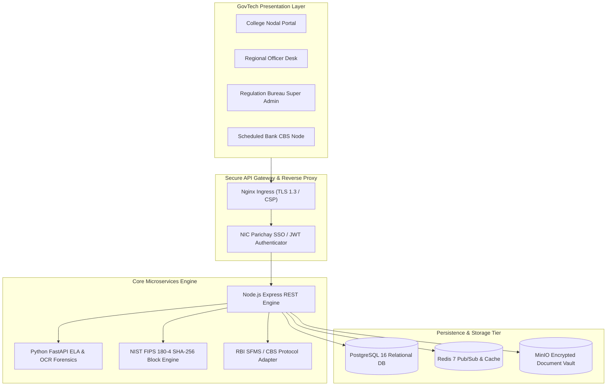
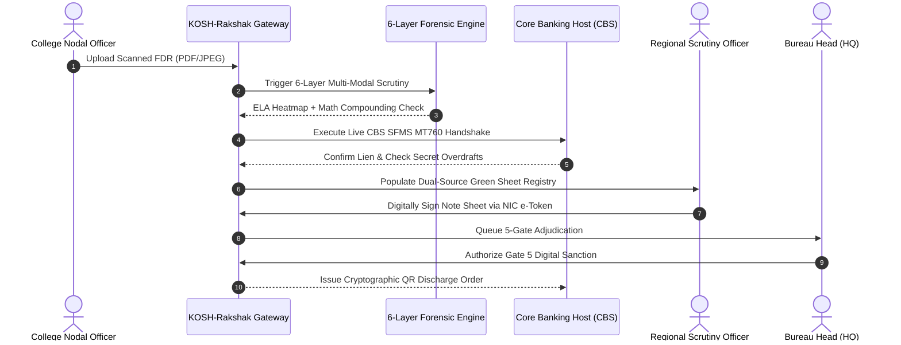

# AICTE KOSH-Rakshak: Technical Architecture Document

## 1. System Context & Overview
The **AICTE KOSH-Rakshak** platform provides unified, end-to-end lifecycle management, algorithmic verification, and cryptographic custody for technical educational institutions' mandatory security deposits under the AICTE Approval Process Handbook (APH 2026-27).

---

## 2. Dual-Source Corroboration Sequence

---

## 3. Cryptographic Proof Standard
- Block header hash calculated over:
  $$\text{CurrentHash} = \text{SHA256}(\text{Index} \parallel \text{Timestamp} \parallel \text{Role} \parallel \text{User} \parallel \text{Action} \parallel \text{Details} \parallel \text{PreviousHash})$$
- Zero-knowledge Merkle verification ensures individual institutions can verify their deposit status without exposing other institutions' private data.
